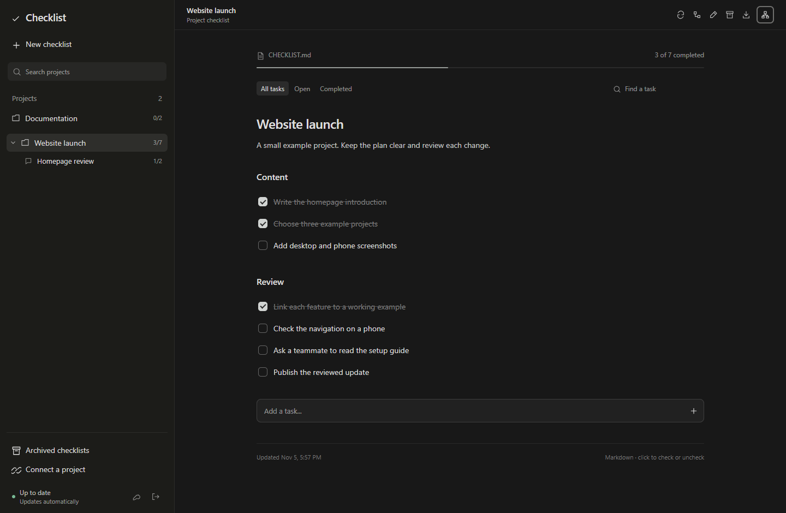
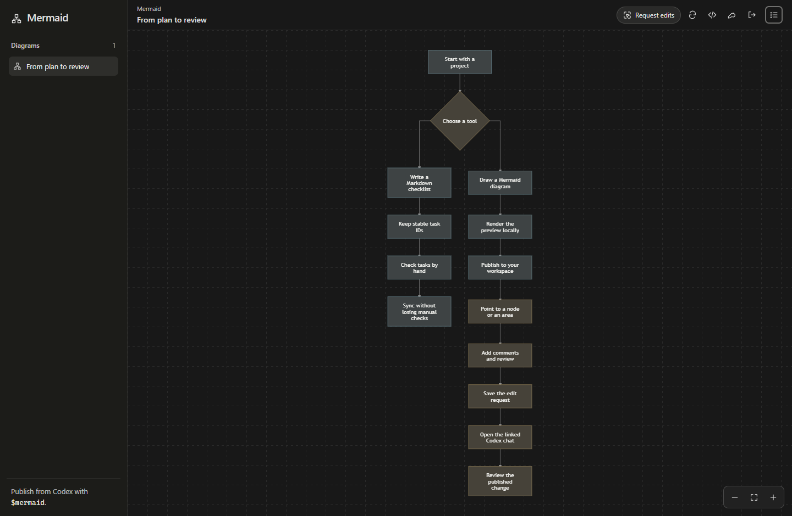
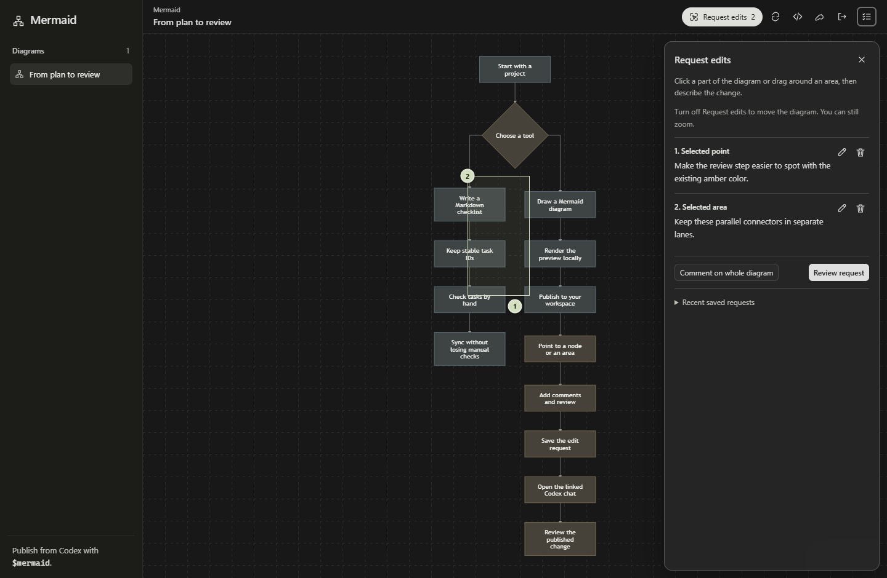
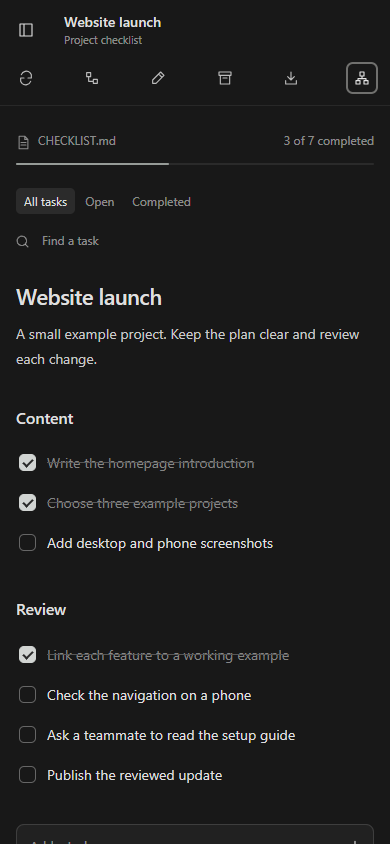

# Checklist + Mermaid Workspace

A self-hosted workspace for **Markdown checklists and Mermaid diagrams**, running on Cloudflare Workers with D1 storage.

Keep a project's tasks in Markdown, check them in the browser, and preserve those manual checks when the source changes. Open Mermaid when you need to explain a process or review a diagram. The two tools share a sign-in and a mode switch, but each keeps its own records, controls and Codex skill.



Screenshots use fictional projects and demo diagrams.

## What you can do

| Tool | What it lets you do |
| --- | --- |
| Checklist | Render Markdown, check or uncheck tasks, search a list and download the effective document. |
| Project and chat grouping | Keep a project checklist together with separate checklists for individual chats. |
| Source synchronization | Publish Markdown with stable task IDs and revision checks while retaining manual checkbox decisions. |
| Archive | Keep a checklist readable while revoking its publishing connection. |
| Mermaid | Publish diagrams independently of checklists, inspect their source, and move around them with pan and zoom. |
| Request edits | Mark points or areas, add numbered comments, review the captured diagram context and save a precise edit request. |
| Private access | Sign in with an owner password and give a connected project access only to its own checklist. |

## Start with a small project

Connect a short checklist and check two tasks in the browser. Add another task to the Markdown source and sync it. The new task appears while your earlier checks remain in place.

For a diagram, publish a Mermaid source file through the separate diagram tool. Connecting a checklist does not create a diagram. That separation is useful when a diagram explains a system rather than a task list.



## Point to the change

Open **Request edits** in Mermaid. Click a point or drag around an area, then describe the change. Add more comments when a review covers several parts of the diagram.

The saved request keeps the diagram ID, source revision, preview checksum, selected view and locations. A request based on an older diagram is rejected so you can reconcile it with the current source before editing.



Use **Copy and open chat** to return to the linked Codex chat, then paste and send the request. Saving a request does not start an agent. Where the Codex browser provides its native annotation API, the review also offers that editor for the current chat.

The Mermaid CLI can read a saved request, which gives an agent the full comments and captured context before it edits and republishes the diagram.

## Run your own workspace

Use a current Node.js release supported by the included dependencies. Start with the [setup guide](docs/SETUP.md), which covers local development, the D1 database, Worker secrets and first-owner sign-in.

```sh
npm ci
npm run build
npm test
```

Each deployment needs its own database and newly generated secrets. Sign in with your own owner key first, then use the password control to choose a browser password. Keep the owner key as a separate recovery and publishing credential.

The setup helper creates ignored local settings and private sign-in files without printing the generated credentials:

```sh
npm run setup -- --url https://your-workspace.example
```

Replace the example URL with your own workspace address and follow the setup guide for deployment. The local Mermaid renderer uses the included Playwright package and an installed compatible browser. Browser installation is a separate step; a build or test run does not download it for you.

## Use the Codex tools separately

The included skill instructions describe the checklist connection and the independent Mermaid workflow. Install or adapt those instructions for your own checkout.

| Request | Tool |
| --- | --- |
| Create or synchronize a connected Markdown checklist | `checklist` |
| Preview, publish or update a Mermaid diagram | `mermaid` |
| Read the comments on a saved diagram edit request | Mermaid CLI `requests show` |

Checklist entries use a permanent-entry workflow: append clarifications and corrections, retain stable IDs, and change checkmarks as work progresses. This workflow is carried by the skill and request text; it is not an immutable database lock against every owner edit.

## On a phone

The project drawer, task controls and edit-request forms adapt to narrow screens. Diagram controls support touch movement and zoom. Long review forms scroll inside their panel.



## What runs where

The Worker serves the two pages and their authenticated APIs. D1 retains checklists, checkbox overrides, diagram records, sessions and edit requests. The checklist CLI sends local Markdown changes, and the Mermaid CLI renders source locally before publishing its SVG preview.

The hosted workspace responds to requests. It does not read files from a switched-off computer or run an AI model in the background. Diagram edit requests become agent work only after a person sends them in Codex.

## Privacy and operating limits

This is a private owner workspace, not a public multi-user service. A public source repository does not grant access to a deployed workspace or its database. Keep credentials, connection files, private documents and local runtime data out of Git. Read the [security notes](SECURITY.md) before deploying or reporting an issue.

Password verification uses a random salt, a separate Worker Secret and a server-side password hash. Read the setup and security notes for the platform's password-derivation limits and recovery procedure.

The application can fit the Cloudflare free allowances for small workloads. Requests, database activity and storage still consume the account's quota. Review current [Workers pricing](https://developers.cloudflare.com/workers/platform/pricing/) and [D1 pricing](https://developers.cloudflare.com/d1/platform/pricing/) for your deployment; there is no unlimited-hosting guarantee. Codex usage follows your own account and plan.

The preview renderer routes flowchart outputs from the bottom and inputs through the top. Distinct ports and separate lanes help keep connectors readable. Dense diagrams can still contain perpendicular crossings; inspect the rendered result at a useful zoom before publishing it.

## Contributing and reuse

Use the [contribution guide](CONTRIBUTING.md) for reproducible bug reports and changes. Include a small fictional example when reporting a rendering or synchronization problem.

A license has not yet been selected for this release candidate. Public visibility alone does not grant permission to reuse or redistribute the code. Confirm the repository's license before doing so.
